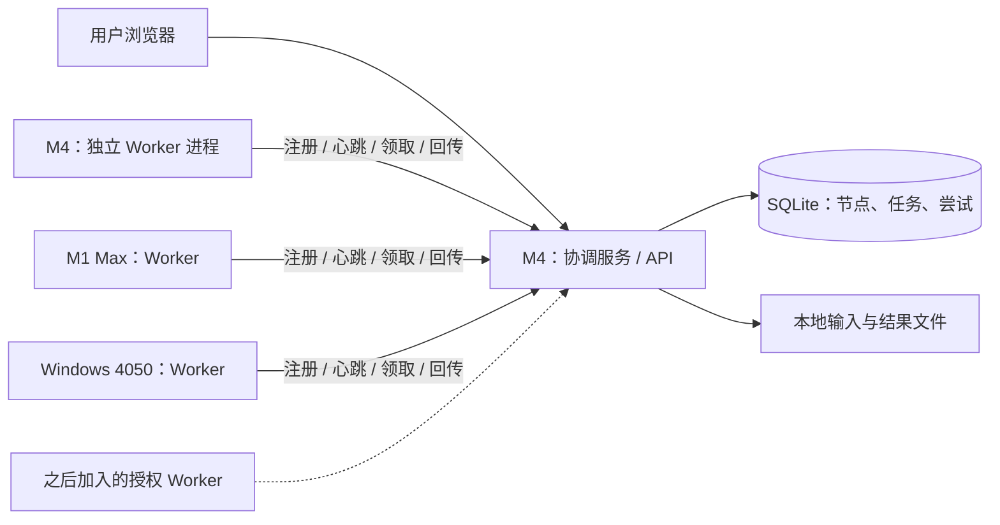
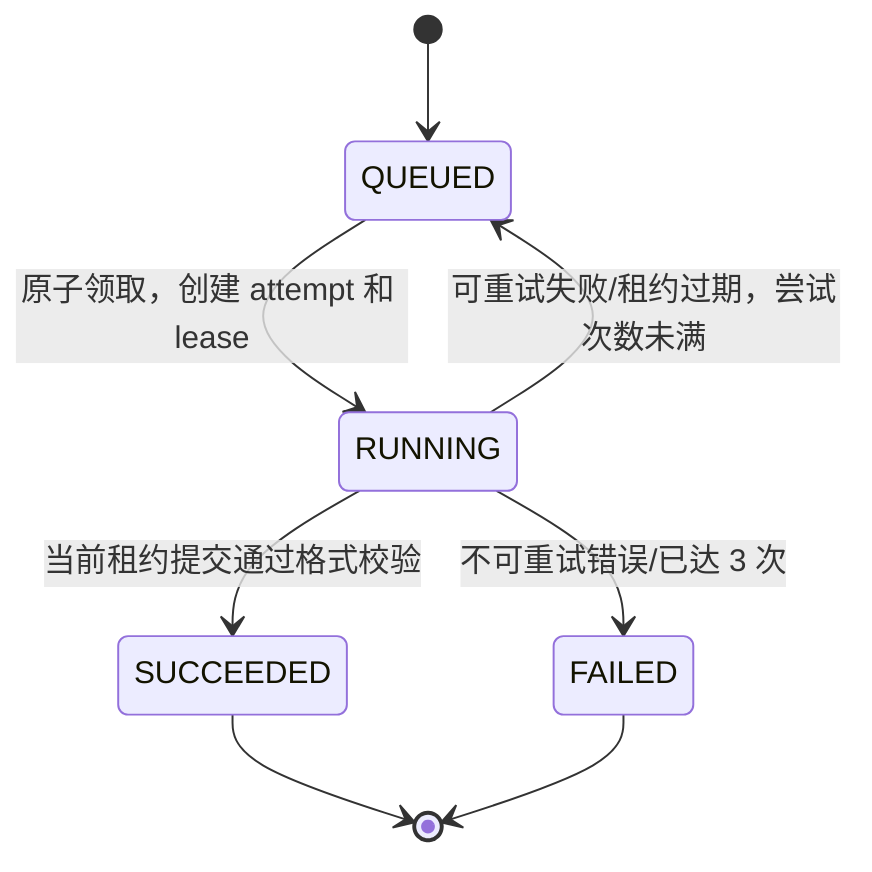

# 架构与接口说明

契约版本：`0.1.0`。HTTP 字段以 [openapi.yaml](contracts/openapi.yaml) 为准；本文件定义字段之外的运行语义。

## 架构和物理设备



协调服务不做模型推理。M4 的推理通过独立 Worker 进行，并纳入其单机基线和资源记录。关闭 M4 Worker 可以演示退出；关闭协调服务会中断整个服务。这一限制必须在演示和 README 明示。

建议栈：Python 3.11、FastAPI、SQLite、本地文件；Worker 使用 Python、HTTP 客户端、psutil、rembg/ONNX Runtime、Pillow；前端 React + Vite + TypeScript。依赖具体版本由 P2、P1 在首次通过后锁定，不安装未验证的最新版组合。单进程协调服务配 SQLite 事务，避免多个 Uvicorn worker 共享不一致的内存状态。

网络使用已验证设备互通的私有局域网/热点；不要假设校园 Wi-Fi 允许设备互访。Worker 只主动访问协调服务，不要求对每台电脑开入站端口。前端生产版同源部署；开发时用 Vite 代理。固定协调服务端口建议 8000。

## 用户与 Worker 的接入

前端使用 `DEMO_TOKEN`。Worker 注册使用独立 `JOIN_TOKEN`；注册后使用服务返回的节点令牌。令牌从环境变量或界面输入，不写进源码、不出现在日志或下载 URL 中。演示范围是受控团队网络；跨公网与复杂账号体系留到赛后。

Worker 启动命令由 P2 实现为：

```text
python -m worker --server http://<协调机局域网IP>:8000 --name <设备名> --backend auto
```

`JOIN_TOKEN` 放在本机环境变量。首次运行生成持久化 `installation_id`，每次进程启动生成新 `instance_id`。同一 `instance_id` 的注册重试返回同一会话；同安装的新实例注册使旧会话和旧租约失效，避免旧进程回传被接纳。

接入链：**初步探测配置 → 注册 WARMING → 验证执行后端与模型加载 → 3 张固定校准样本 → READY → 允许领取**。P2 将三张授权校准图及其 SHA 清单放在 `worker/calibration/`，全部设备使用同一组；校准图片不算业务任务和吞吐。模型可以提前下载；现场展示的“加入耗时”须区分首次安装、首次加载、已预热接入。

## 配置识别如何影响分配

自动探测 OS/架构、CPU 逻辑核数、总内存/可用内存；NVIDIA 信息在工具可用时读取；ONNX Runtime 报告可用 provider，并实际创建会话跑样本。Mac 统一内存写在内存栏，未知独立显存写 `null`，不能填 0 或按 64GB 显存宣传。

允许用户补充 CPU/GPU 的显示名称和备注，标记 `manual`。这些字段不改变实际可用 provider、模型加载结果或实测速度。配置检测失败时允许 CPU 自测路径继续，前端显示“部分信息未检测到”。

当天资源策略固定：

- 一个 Worker 一个任务槽位；CPU 线程数默认 `max(1, min(4, logical_cores // 2))`，核数无法探测时用 1，可由设备所有者下调，正式测试固定。
- `auto` 在实际 CUDA 会话与自测成功时使用 CUDA，否则使用 CPU 并记录降级原因。CoreML 不在当天必需路径中。
- 只有 `pipeline_id`、模型 SHA256 与服务器当前配置一致且自测通过的节点可领任务。
- 节点 READY 后不能在活动尝试中更换后端、模型或线程配置；先 DRAINING 到空闲，再重新预热校准。正式测量期间变更配置须重跑对应基线。
- 取任务遵循 FIFO；领取端点按在线、READY、ACTIVE、槽位空闲、资源未被设备所有者暂停进行过滤。
- 谁先完成谁再请求一张，因此快设备在同样时间内自然多完成任务。配置是能力与限额依据，实测耗时用于估算速度，**不按“内存大小比例”硬分图片**。
- 控制台显示每台的实测处理速度和已完成贡献。可选用最近 10 次成功任务的 EWMA 估计剩余时间；标“估计”，断线后重算。它不决定正确性。

这种拉取机制不要求节点数固定，不预先把一批图片平均切成三大份，也不会把整批任务长期压在一台慢机器上。

## 状态和退出

Worker 的可报告阶段：`WARMING / READY / ERROR`。服务器控制模式：`ACTIVE / DRAINING / PAUSED`。显示状态由服务器派生为 `WARMING / READY / BUSY / DRAINING / PAUSED / OFFLINE / ERROR`。

优先级：OFFLINE → ERROR → DRAINING → PAUSED → WARMING → BUSY → READY。heartbeat 3 秒一次，15 秒未收到心跳转 OFFLINE；扫描间隔最多 1 秒。控制台每 2 秒轮询，所以异常出现到页面反馈目标为 18 秒以内。

正常退出：用户请求 DRAINING，服务器立即停止该节点领取；已有任务继续运行和续租，完成后变 PAUSED。Worker 可以保持心跳待恢复，或优雅退出进程。恢复 ACTIVE 后重新做必要的就绪检查再领取。

异常退出：断网/进程终止，租约到期后把尚未成功的任务重新排队。其他节点继续。重启旧节点后以新会话注册；旧尝试晚到会被拒收。

如果所有 Worker 都不可用，Job 保持 `WAITING_FOR_WORKERS`，页面解释等待原因；有兼容节点恢复后继续。结果和输入仍在协调机。

## 一张图的任务生命周期



逻辑任务 `task_id` 不变；每次领取生成新的 `attempt_id` 和随机 `lease_token`，记录 `worker_id`、`session_id`。初始租约 15 秒，有效 heartbeat 为报告中的当前 attempt 续租；**每次尝试绝对截止 120 秒**，心跳不得无限延期。

每张图最多 3 次领取尝试。一次尝试失败后优先给其他兼容节点机会：该任务对刚失败节点冷却 10 秒；只有该节点在线时，冷却结束可再领。输入损坏、模型不兼容等不可重试错误直接终止。与其他任务无关的单图失败不能让整批一直卡住。

Heartbeat 必须与推理解耦，否则慢推理会导致“假掉线”。Worker 收到尝试已撤销，丢弃该尝试结果；如果当前库调用暂时无法中断，等待返回再继续，不能再上传成成功。永久卡住的本机推理应进入 ERROR 并停止领取，其他节点可接走过期任务。

`POST complete` 的事务必须同时验证：当前会话、当前 attempt、lease_token、尚未过期、模型/流水线匹配、结果格式有效。写文件使用 attempt 专属临时路径；校验后原子发布引用并将任务置为 SUCCEEDED。没有 DB 引用的临时文件不对用户暴露，后续可清理。

提交有稳定 `submission_id`。已成功的相同 attempt、submission_id 和相同内容重传返回同一成功确认，不再计数；同 ID 不同内容或已换 attempt 返回 409。响应丢失时 Worker 可以重发固定的完整载荷。

这里保证的是**逻辑结果只接纳一次**。故障时可能发生物理计算重做，不宣称“计算恰好执行一次”。重复耗时计入故障成本，不能计入有效吞吐。

Job 状态由任务派生：全成功 `SUCCEEDED`；全部终止且一部分成功 `PARTIAL_FAILED`；全部失败 `FAILED`；存在正在运行任务 `RUNNING`；有待处理任务但无可用/正在工作的兼容节点 `WAITING_FOR_WORKERS`；其余 `QUEUED`。

## 数据和时间

至少保存 Worker、WorkerSession、Asset、Job、Task、Attempt、Event、Telemetry。Task 的当前 attempt 和计数更新必须在数据库事务中完成。FIFO 同时领取只允许一方成功；单进程锁可以辅助，但不能代替持久化的条件更新。

协调服务时间是租约唯一权威，租约判断不使用客户端墙钟。Worker 内部耗时用单调时钟。所有 API 时间为带 Z 的 UTC；前端按北京时间展示。协调服务重启后先撤销未完成尝试再开放领取，并写事件；该恢复行为要实测，不能把 SQLite 文件存在等同于恢复已完成。

## 接口对接表

| 端点 | 调用方 → 实现方 | 核心约定 |
|---|---|---|
| `GET /healthz` | P4 → P1 | 无鉴权，服务与契约版本 |
| `POST /v1/assets` | P3/P4 → P1 | 单文件 multipart，返回规范化输入 ID |
| `GET /v1/assets/{asset_id}` | P3/P2/P4 → P1 | 鉴权文件读取；Worker 只读自己当前有效任务的输入 |
| `POST /v1/jobs` | P3/P4 → P1 | JSON：input_ids、preset、client_request_id；创建幂等 |
| `GET /v1/jobs/{job_id}` | P3/P4 → P1 | 进度、每个逻辑任务、全部尝试、结果引用 |
| `GET /v1/jobs/{job_id}/download` | P3/P4 → P1 | 终态 ZIP；部分失败时附失败清单，未结束返回 409 |
| `GET /v1/pool` | P3/P4 → P1 | 节点、资源、累计贡献、最近 100 条真实事件 |
| `POST /v1/workers/register` | P2 → P1 | 加入令牌；返回 worker/session/worker_token |
| `POST /v1/workers/{id}/heartbeat` | P2 → P1 | 阶段、有效能力、活动 attempt、资源采样、校准结果 |
| `POST /v1/workers/{id}/claim` | P2 → P1 | 一次最多一张；无工作 204；无响应时先用 heartbeat 对账 |
| `POST /v1/workers/{id}/mode` | P3 或该 Worker → P1 | ACTIVE 或 DRAINING；不强杀推理 |
| `POST /v1/tasks/{id}/complete` | P2 → P1 | multipart：JSON meta、三种输出；带 attempt 和 lease |
| `POST /v1/tasks/{id}/fail` | P2 → P1 | JSON：尝试、租约、错误码、可重试性 |

所有接口使用 bearer token。使用哪一种令牌由端点角色决定。Worker 不得查询其他节点凭证；`GET pool` 也不返回任何 token。

## 丢包、格式和前后端约定

- 领取请求包含 `claim_request_id`：同一会话同请求 ID 重试返回原任务、原租约，不能额外领一张。如果该尝试已结束或被撤销，返回 409。首次无任务的 204 不固化为幂等记录。
- Job 创建使用 `client_request_id`：同 ID 同参数返回同 Job，同 ID 不同参数 409。相同输入 ID 不能在同 Job 出现两次；同 Job 相同输入内容 SHA256 拒绝作为重复条目。
- 心跳请求只有完整的当前活动 attempt 列表；响应同时给出服务器认可的活动租约和撤销 ID。Worker 不凭自己“认为领取失败”再领第二个任务。
- 所有错误使用 `{"code":"...","message":"...","retryable":false}`，HTTP 状态见 OpenAPI。不得用 HTTP 200 搭配字符串 `error` 隐藏失败。
- 前端下载图片使用带 Authorization 的 fetch 获取 Blob，再生成对象 URL。不得把 token 拼在 `` 查询参数中。
- 任务进度按唯一 `task_id` 统计。客户端显示“执行完成”与“质量已通过人工/基准检查”两种证据，不能混淆。
- P3 不连接 Worker。P2 不读取 SQLite。P4 黑盒验收用真实 API，不通过直接改数据库制造恢复效果。
- P4 需要的原始记录从 Job 响应导出，设备采样从 pool 轮询采集。没有必要新增专用测试后门或 WebSocket。

## 冻结规则

P1 维护契约，P2 维护流水线 manifest。字段或状态语义变更先写规范和变更记录，再通知 P3/P4。今晚 22:00 后不改接口，除非是阻止核心流程的缺陷；一旦改动必须重跑对应验收。正式基线采集后改模型、线程、后端或批大小必须重新采集受影响的对照。
