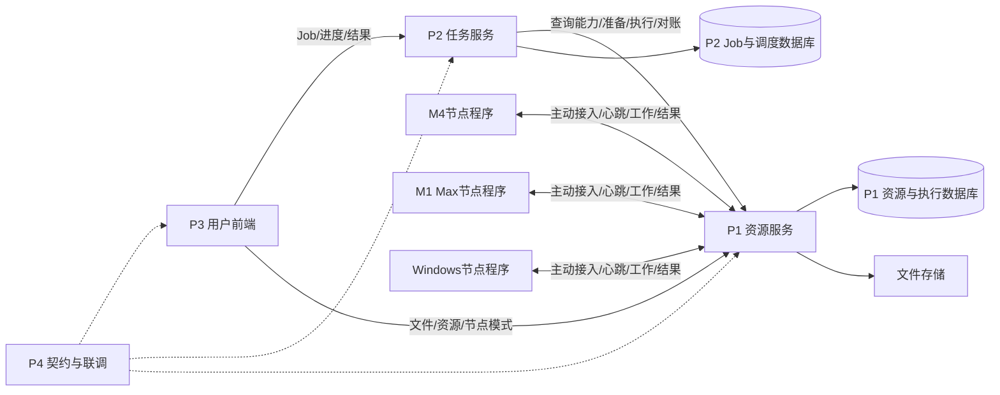

# 架构与责任边界

版本：0.2.0。字段见 [OpenAPI](contracts/openapi.yaml)，顺序、竞态、超时和错误见 [接口手册](05-接口契约与联调手册.md)。

## 两层服务和真实节点

计划将 P1/P2 中心服务运行在 M4 上的不同进程，节点程序与中心服务分开；M4参与计算时也作为普通节点计入证据。物理部署可调整，但职责和服务 API 不变。

建议 P1/P2 采用 Python HTTP 服务、各自 SQLite 和独立数据目录；P1节点执行器用相应本地模型环境；P3 React/Vite/TypeScript。依赖由实现者实测锁定，不据此承诺已安装。双方不共享数据库表，不依赖内存对象或导入对方业务模块。

## 唯一责任归属

| 对象/决策 | 唯一所有者 | 对外观察 |
|---|---|---|
| 设备、会话、硬件、心跳、在线/模式 | P1 | resources |
| 模型配置、准备、校准、实际 provider | P1 | task-types、resources、preparations |
| 文件字节、SHA、元信息、传输 | P1 | artifacts |
| 单次执行、占槽、执行期限、单次终态 | P1 | executions、events |
| Job、逻辑 Task、输入顺序、拆分合并 | P2 | jobs、results、download |
| 选择节点、业务重试预算、最终去重 | P2 | Task 及 execution 关联 |
| 页面状态展示 | P3 | 消费 P1/P2 HTTP，不自己改变业务事实 |
| 验收结果、独立质量、正式性能 | P4 | 原始证据和报告，不回写伪造业务状态 |

P1 的资源分配是“接单时原子检查并占用槽位”；P2 的任务分配是“决定哪个子任务交给哪个节点”。P1不跨节点补派，P2不擅自推断正在执行的任务已经失败。

## 状态模型

- 节点连接：ONLINE/OFFLINE；控制模式：ACTIVE/DRAINING/PAUSED。只有 ONLINE+ACTIVE 可接受新准备和新执行。
- 节点能力：UNAVAILABLE/NOT_PREPARED/PREPARING/READY/ERROR，按 task_type/profile 分开记录。READY 必须有实际后端及自测证据。
- 准备：ACCEPTED → DOWNLOADING/LOADING/VERIFYING → READY 或 FAILED；业务拒绝为 REJECTED。
- 单次执行：ACCEPTED → RUNNING → SUCCEEDED/FAILED；取消走 CANCEL_REQUESTED → CANCELLED；业务拒绝为 REJECTED。终态不变。
- 逻辑任务：QUEUED/WAITING_FOR_RESOURCES/DISPATCHING/RUNNING/CANCELLING/SUCCEEDED/FAILED/CANCELLED，由 P2管理。
- Job：QUEUED/WAITING_FOR_RESOURCES/RUNNING/CANCELLING/SUCCEEDED/PARTIAL_FAILED/FAILED/CANCELLED，由逻辑任务和取消标记派生。

“执行成功”表示真实执行与输出结构校验通过，独立业务质量未必通过。三者不能在 UI 或性能分子中混写。

## 文件流与身份链

P3上传原文件至 P1，拿到 artifact_id；P2按类型检查元信息并创建 Job/Task；P2给 P1 execution 时携带 artifact_id；P1节点通过受控通道取文件，生成结果 artifact；P2取回并校验、按 input_index 汇总，P3从 P2读取结果/下载 ZIP。

追溯链：client_request_id → job_id → task_id/input_index → execution_id/attempt_no → worker_id/session_id → 输入 SHA/profile_digest → 结果 artifact SHA。

本版无需 P2预切文件。后续需切 PDF/音频时，P2负责生成分片并上传 P1获得新 artifact_id，记录原文件/分片关系；不能传某台机器的绝对路径让别的机器猜。

## 资源与模型

首版每节点一个执行槽，一个模型准备也占该槽。每节点一个驻留 profile；空闲切换时明确更新旧能力状态。调度优先使用已 READY 节点，避免在队列仍有同类型工作时反复切模型。

硬件是配置依据，自测和实际运行后端才是可执行证据。Mac统一内存写内存栏，独立显存未知为 null。没有 GPU 采样时显示 N/A，不填 0；不按内存比例承诺速度。

节点程序只主动访问 P1，局域网或热点必须实测互通。节点注册/内部工作协议由 P1维护，P2/P3不开放或访问节点入站端口。每设备单一节点主进程，防止同一设备被重复算为两台物理机器。

## 恢复与取消

- P1失去节点心跳：终止受影响执行并撤销旧提交权；P2看到明确失败后按预算重派。
- P1中心不可达：P2保持 DISPATCHING/RUNNING 与连接原因，恢复后对账，不凭 HTTP 超时另派。
- P1重启：保留文件和所有终态/幂等记录；将未终止 execution 标 FAILED（RESOURCE_SERVICE_RESTARTED），未完成准备标 FAILED，旧会话失效；新会话重新自测后接单。
- P2重启：恢复请求 ID 和 Job/Task/执行映射，先查询或重放原请求，避免重复派单。
- P2取消 Job：停止新派发；未派发任务取消，已派发任务请求 P1取消。P1成功与取消原子竞争：已成功保留成功，取消先取得提交权则拒收之后的结果。若有未对账请求，不能提前把 Job 标终态。

终止提交权不等于本机计算已停。P1必须在节点确认停止前把该节点槽保留为不可用；节点重连先停止旧执行并建立新会话，再报告空闲。建议模型计算放在可终止的子进程，心跳独立于推理。

## 独立开发约定

P1可用契约请求直接测试；P2用模拟 P1；P3用模拟双服务；P4从第一天提供共享模拟及验收工具。所有模拟与真实模式有明确标记，正式证据只取真实执行。

代码归属见四份任务卡。公共接口每次只由 P4合并发布一个版本，模块内部实现由各自负责人决定。每人需要交付启动/停止、地址/令牌、数据目录和模块自测说明，不能把本机环境留给下一个人猜。
