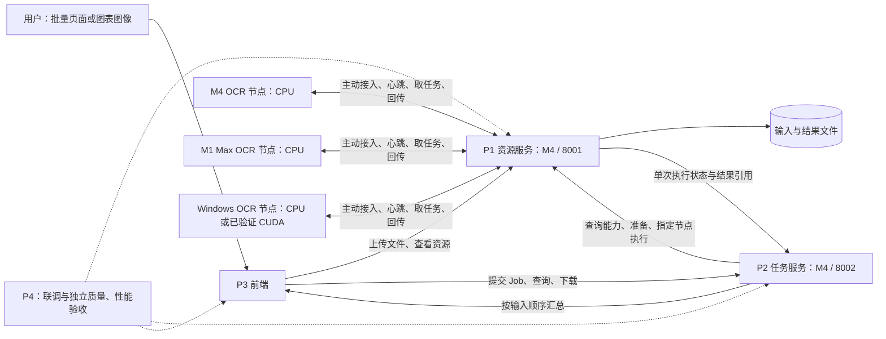

# 项目概况与 OCR 任务补充声明

日期：2026-11-14（北京时间）。适用基础：现有执行计划与接口契约 **0.2.0**。

**本项目此次确定的具体业务任务是：批量文档 / 学术图表 OCR 解析，采用 RapidOCR 组织文字检测、文本行方向分类和文字识别，由 ONNX Runtime 在团队现有 Mac 与 Windows 设备上执行推理。系统将一批页面或图表图像按文件拆分，分配到可用设备并行处理，再按输入顺序汇总可复制、可下载、可追溯的识别结果。**

本文补齐“现有资源平台究竟为哪一种实际任务分配算力”的业务定位。P1–P4 的主责、代码归属、接口、状态机、时间表和验收标准继续沿用原文件；本文不替换任务卡，也不发布新契约版本。已有 `asr.file.v1` 定义及相关验收项保持原状，不混入本次 OCR 的任务量或性能指标。

当前仓库提供设计文档、契约和合成样例，尚无应用实现或真实多机运行证据。下文是已确定的实施方向；模型配置发布、设备就绪与性能达标仍需依照原计划验证。

## 1. 面向谁，解决什么任务

面向需要整理文献、课程资料和研究记录的校园科研小组、课程团队及学生。典型输入是扫描文档页面、论文截图、讲义照片、表格截图和学术图表；用户希望批量提取其中的文字，减少逐张录入和逐文件处理的操作。

这里的“学术图表解析”具体指识别图题、图例、坐标轴标签、表头、单元格中可见的文字与数字，并保留文本位置。首版交付的是**文字及文本框**；公式转 LaTeX、表格行列与合并单元格还原、曲线数据提取、复杂版面重建和论文语义理解不在现有 `OCRResult` 的能力承诺内。印刷体中英文是首批验证对象；手写、模糊、小字和复杂多栏样本须单独验证质量。

产品价值是通过一个入口调用队内已有设备，完成批量识别、进度查看和结果归集。跨机并行是否比单机更省时、是否值得承担传输和部署成本，由真实对照实验回答；目标用户与使用价值仍属于待验证的产品假设。

## 2. 输入、拆分与交付结果

直接复用 [任务类型目录](contracts/task-types.json) 中的 `ocr.image.v1`，不新建另一套 OCR 类型或输入字段。

| 项目 | 本任务的具体约定 |
|---|---|
| 用户提交 | 一批 JPG/JPEG 或 PNG 图像；每个 Job 1–200 个输入 |
| 单文件限制 | 原文件不超过 10 MiB，解码后不超过 20,000,000 像素 |
| 文档来源 | 文档以页面图像进入系统；PDF 先在系统外导出为 JPG/PNG，再按页序提交 |
| 拆分单位 | 一张图像对应一个逻辑 Task；不把单张图片的检测、分类、识别拆到不同电脑 |
| 顺序与重复 | `input_index` 按提交数组从 0 编号；同一 Job 的重复原字节 SHA 按现有规则拒绝 |
| 参数 | 沿用 `language=auto/zh/en`，实际可选语言由 P1 发布的 profile 决定 |
| 单次结果 | 一份规范 `OCRResult`：全文、文本块、文本框位置及置信度或 `null` |
| 批量结果 | P2 按输入顺序返回逐图结果、失败项和 `combined_text`，提供终态 ZIP 下载 |

“批量文档”描述输入的业务用途；现有 HTTP 接口仍只接收上述图片，不增加 PDF 上传、服务端 PDF 拆页或新参数。页面图像跨机独立执行，每个节点在本机完成一张图的完整 OCR 流程。

ZIP 沿用现有约定：`manifest.json`、`results.json`、`combined.txt`，以及每个成功任务的 `results/{input_index四位}-{task_id}.json`。用户可以将文本用于笔记或 Markdown 整理；本文不增加 Markdown 文件导出或原文版式还原的交付要求。

## 3. 推理引擎与单图处理方式

**OCR 封装选用 RapidOCR，推理引擎固定为 ONNX Runtime，模型采用 RapidOCR 支持的 PP-OCR 轻量 ONNX 检测、方向分类与识别组合。** 模型直接在每台计算设备运行，正式识别不依赖外部云端 OCR API。

新实现采用官方当前维护的 `rapidocr` 包并显式安装 ONNX Runtime；附件中提到的 `rapidocr_onnxruntime` 属于同一技术路线，官方已将后续开发集中到 `rapidocr`。CPU 环境使用 `onnxruntime`；Windows 若启用 CUDA，则使用与驱动、CUDA/cuDNN 匹配的 `onnxruntime-gpu` 环境。具体依赖版本由 P1 实测后锁定，不以未锁版本的安装命令作为交付配置。[RapidOCR 安装说明](https://rapidai.github.io/RapidOCRDocs/main/en/install_usage/rapidocr/install/)、[ONNX Runtime CUDA 说明](https://onnxruntime.ai/docs/execution-providers/CUDA-ExecutionProvider.html)

P1 在既有执行器职责内完成如下流程：

1. 通过 P1 的文件机制取得图像原字节，解码并纠正 EXIF 方向，检查尺寸与像素限制。
2. 按冻结配置预处理，在同一设备依次执行文字检测、文本行方向分类和文字识别。模型在准备阶段加载并实际试跑，后续任务复用已准备实例。
3. 将 RapidOCR 输出转换为现有 `OCRResult`。若引擎输出四点多边形，取轴对齐外接矩形映射为 `bbox=[x0,y0,x1,y1]`；缩放坐标须还原到 EXIF 方向纠正后的原图空间，并限制在图像边界内。
4. 固定文本块排序与拼接规则，输出 `text`、`blocks[].text/bbox/confidence`；无文字图像按规范保留空结果，不填造识别内容。复杂多栏的阅读顺序另作质量检查。
5. 按现有执行协议持久保存结果，通过 schema、输入关联和提交权检查后发布结果 artifact，由 P2 取回并汇总。

首个配置沿用 `profile_id=ocr.default.v1`。检测、分类、识别权重及字典、依赖、预后处理、语言和允许后端应冻结为同一套可复现配置，各设备使用同一个 `profile_digest`。官方默认模型会随版本变化，因此须固定模型文件与校验值，不能只写“使用 RapidOCR 默认模型”。[RapidOCR 模型与使用说明](https://rapidai.github.io/RapidOCRDocs/main/en/install_usage/rapidocr/usage/)

P1 仍按 [运行配置模板](contracts/runtime-manifest.example.json) 和 `RuntimeProfile` 发布真实锁文件；本文不填写假权重 SHA，也不将模板改成 `CONFIGURED`。任务和引擎选型已经确定，精确权重、包版本、资源门槛及自测结果属于原有模型准备交付。只有配置已发布、节点真实自测通过且摘要匹配，能力才能为 `READY`。

## 4. 现有设备如何参与资源分配

以下以 [P1 任务卡](tasks/P1-资源接入与执行.md) 和现有架构登记的设备为规划依据，设备配置记录不等于已接入或已实测。

| 设备 | 沿用的部署角色 | OCR 推理安排 | 资源安排 |
|---|---|---|---|
| Apple M4，16GB 统一内存 | P1 资源服务、P2 任务服务所在协调机；可另运行一个计算节点 | `backend=cpu`，`runtime_provider=CPUExecutionProvider` | 优先保障中心服务、文件传输和页面访问；参与计算时使用独立节点进程、单槽并限制推理线程 |
| Apple M1 Max，64GB 统一内存 | 独立计算节点 | `backend=cpu`，`runtime_provider=CPUExecutionProvider` | 承接整张图像的 OCR；沿用单槽，不按 64GB/16GB 比例硬分任务 |
| Windows，RTX 4050 Laptop | 独立计算节点 | 先验证 CPU；CUDA 适配与自测通过后可使用 `backend=cuda`、`CUDAExecutionProvider` | CPU、内存、显存、驱动及网络参数由 P1 核实；设备名称本身不作为 CUDA 已可用的证据 |

现有执行包按三台设备规划；附件另提到“1–2 台 Windows”，第二台 Windows 尚未在当前设备清单确认，不计入基础承诺。Mac 的统一内存记录在内存字段，不能直接当作独立显存。

**首轮先以 CPU 路径完成跨平台闭环，再评估 Windows CUDA 的实际收益。** 两台 Mac 即可验证两台物理设备协同；三机能力在 Windows 加入并产生有效结果后确认。ONNX Runtime 官方也提供 CoreML 路径，但现有契约的 `backend/allowed_backends` 仅允许 `cpu/cuda`，本补充沿用这一范围，不新增 MPS/CoreML 枚举或将其伪报为 CPU。[ONNX Runtime CoreML 说明](https://onnxruntime.ai/docs/execution-providers/CoreML-ExecutionProvider.html)

资源分配仍由原有两层职责执行：

- **P2 逐张分配：** 在同一 OCR 队列中，按现有稳定轮询策略选择 `ONLINE + ACTIVE`、profile 匹配、能力 `READY` 且有空槽的节点。节点完成并释放槽位后继续接单，处理较快的节点自然能够完成更多图片，不预先硬分整批比例。
- **P1 原子接单：** 每节点一个执行槽，模型准备也占槽；P1 在受理时重新检查会话、能力与槽位。目录快照不等于已预约资源。
- **线程与模型复用：** 线程数和识别内部批大小由 P1 在校准后登记并冻结，单机与多机对照保持每台设备配置一致。单槽不等于只能用一个 CPU 线程；M4 须为中心进程留出资源。
- **后端真实可见：** CPU/CUDA 的启用、降级原因和实际 provider 进入能力与运行记录。正式测量期间固定后端；CUDA 不可用时仅在已发布 profile 允许且 CPU 自测通过的条件下按 CPU 接单。不能让同一 Job 静默换模型或摘要。

这种并行方式聚合的是各设备独立完成 OCR 图片的吞吐，不将多台设备的内存、显存合成一个模型运行空间。

## 5. 各模块通过什么方式连接

沿用 [架构](02-架构与接口说明.md) 与 [接口手册](05-接口契约与联调手册.md) 的双服务结构。P1/P2 建议使用 Python HTTP 服务及各自独立的数据目录，P3 沿用 React/Vite/TypeScript；各机器在同一受控局域网或热点内通过 HTTP 传输文件与 JSON，不共享进程内对象或数据库表。



| 连接步骤 | 沿用接口及数据流 |
|---|---|
| 1. 接入与准备 | 节点主动连接 P1，由 P1 管理注册、心跳与内部工作协议；P2 经 `GET /api/resource/v1/resources`、`GET /api/resource/v1/task-types` 查询能力，必要时调用 `POST /api/resource/v1/preparations` 并查询准备状态，等待 `READY` |
| 2. 上传图片 | P3 向 P1 `POST /api/resource/v1/artifacts` 上传原字节，获取 `artifact_id`、SHA 与元信息 |
| 3. 提交批次 | P3 从 P2 `GET /api/task/v1/task-types` 获取已配置类型，再向 `POST /api/task/v1/jobs` 提交 `task_type=ocr.image.v1`、profile 标识与摘要、输入 artifact 数组、语言及稳定的 `client_request_id` |
| 4. 拆分派发 | P2 一图一 Task，保存 `input_index`；先持久化执行请求，再向 P1 `POST /api/resource/v1/executions`，指定节点、会话、输入 artifact 与 profile |
| 5. 本机推理 | P1 受理占槽，节点取得图片并运行完整 RapidOCR/ONNX Runtime 流程，将结果交回 P1 |
| 6. 汇总展示 | P2 获取并校验结果 JSON、持久保存后汇总；P3 通过 `GET /api/task/v1/jobs/{job_id}` 查询状态，通过 `GET /api/task/v1/jobs/{job_id}/results` 预览，并在终态通过 `GET /api/task/v1/jobs/{job_id}/download` 取得 ZIP |

请求字段和响应码以 [OpenAPI](contracts/openapi.yaml) 为准。配置继续使用 `RESOURCE_BASE_URL` 和 `TASK_BASE_URL`，填写调用方实际可达的地址；P3 通过同源代理分别转发 `/api/resource` 与 `/api/task`。跨电脑不使用 `localhost` 或某人的磁盘路径传递文件。

浏览器使用 `DEMO_TOKEN`；P2 服务端使用 `TASK_TOKEN`；节点使用 P1 管理的 `JOIN_TOKEN` / 会话凭证。P2/P3 不直接访问节点端口，节点不自行向别的设备重派任务。

连接异常、重试、取消和恢复继续按原契约处理：P2 的 HTTP 超时不代表执行失败，先用原 execution ID 对账；P1 明确失败且可重试后，P2 才可按最多三次已接受尝试的预算重新派发。结果按逻辑 Task 去重并保持输入顺序，失败项保留在最终清单中。

## 6. 对 P1–P4 原分工的场景补充

下表只是将已选定的 OCR 业务对象填入各人的既有职责，不增加第五条工作线，也不转移模块责任。

| 既有分工 | 在本 OCR 场景中的具体对象 | 沿用的交接内容 |
|---|---|---|
| [P1：资源接入与执行](tasks/P1-资源接入与执行.md) | 三类设备接入；RapidOCR/ONNX Runtime 环境、模型准备、单图推理与结果适配 | 资源/文件/执行 API，真实 OCR profile、实际后端、自测记录；供 P4 使用的同一执行器离线基线入口 |
| [P2：任务分析与调度](tasks/P2-任务分析与调度.md) | 校验图片批次，一图一 Task，选空闲节点，处理重试与按序合并 | Job API、输入顺序、Task/execution/worker 关联、JSON/TXT/ZIP；不承担 OCR 模型执行 |
| [P3：前端体验](tasks/P3-前端体验.md) | 选择已配置 OCR 类型、批量上传、逐图状态与文字预览、设备贡献和下载 | 沿用双服务客户端与配置；未配置或未接通如实展示；不在浏览器新增调度或推理 |
| [P4：验收压测与演示](tasks/P4-验收压测与演示.md) | 文档与学术图表图片的参考文本、OCR 质量、多机贡献与吞吐证据 | 沿用验收清单、模型/输入 hash、离线和服务基线、设备记录及演示；不另写一套 OCR 推理 |

## 7. 本场景如何证明完成

沿用 [时间表与演示](04-时间表与演示.md) 的 G0–G6 流程，以及 [验收与压测](03-验收与压测.md) 的 R/T/U/I/X/B 用例和正确性分层。

演示主线为：**用户提交一批新的授权页面或图表图像 → 页面显示逐图进度与执行设备 → 同一 Job 至少两台物理设备各完成有效结果 → 按输入顺序预览文字并下载 ZIP → 展示同口径单机与多机对照。** 节点退出、失败恢复和中心服务恢复仍按原验收项分别验证。

OCR 质量集沿用至少 20 份不同授权输入的起始要求，覆盖中英文页面、图表文字及困难样本；参考文本、归一化规则与质量阈值由 P4 在正式测量前冻结。HTTP 成功、schema 通过或有非空文本不能代替独立质量通过。表格图片先验文字与数字，不把未实现的结构还原列为识别成功证据。

性能单位为**正确图片/秒**。先测每台参与计算设备的本地完整执行器，再测 P1/P2 单节点服务及固定设备集合的多节点服务；同一模型配置、可比输入、各节点冻结的后端/线程/批大小/槽位保持一致。沿用：

```text
聚合效率 = P_pool / Σ P_i × 100%
相对最强单机提升 = P_pool / max(P_i)
```

其中 `P_i` 为第 i 台设备的本地正确吞吐，`P_pool` 为完整多机任务服务的正确吞吐。失败、重复计算与未核验输出不增加分子；它们的耗时仍计入窗口。M4 若参与推理，须列入参与设备与基线；若只提供中心服务，则不计为第二台有效计算节点。输入上传、模型首次加载、动态节点实验按原规则单列。

本任务的工程假设是：一批独立图片可以在多机上同时识别，且文字密集页面可能提供足够计算量来分摊调度和传输开销。实际瓶颈可能在网络、中心文件服务、解码、检测或识别，均以测量解释；本文不承诺固定单图耗时、加速倍数或聚合效率区间。

## 8. 依据与适用边界

本声明依据当前执行包的总览、产品定义、架构、接口手册、四份任务卡、类型目录、OpenAPI、合成样例、运行配置模板及验收材料，并核对了压缩包与旧版归档。当前执行包及其 0.2.0 契约是连接依据；归档中的商品图方案和旧 P1/P2 职责仅供追溯。

[用户提供的选型材料](<../TypeBox — Markdown Editor & Format Toolkit.pdf>) 提供了 OCR 方向及设备背景。本文采纳的是用户本次明确选定的 OCR 任务；附件中关于生成代码骨架、模拟耗时的建议不作为本次行动指令，其中“保证安装成功”和高聚合效率的估计也不作为已验证事实。正式联网、有效计算和公平测量要求以 [D 题原文](sources/D题原文-中文.pdf) 与现有执行包为依据。

本次交付仅为这一份补充声明；既有文档、P1–P4 任务卡、contracts、压缩包与归档均不因本声明而改写。
