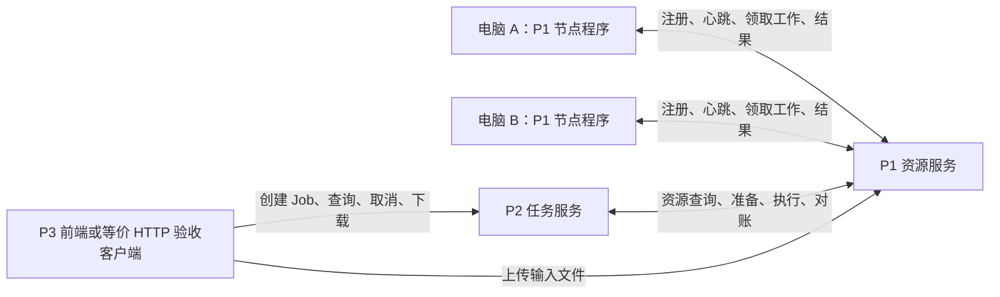

# P1–P2 统一修改与联调计划

计划版本：1.0 · 日期：2026-11-14 · 公共 API 契约：0.2.0

**用途：队友的 Codex 按本文件完成 P1 修改；P2 负责人及其 Codex 按同一文件完成 P2 修改。双方以共同的接口语义和联调结果验收。**

当前状态：计划已编写；实施、回归和真实联调待执行。本文不代表任何用例已经通过。本次仅新增计划文件，不修改业务代码、运行环境或原始契约。

审查基线：P1 `wzq@5bb3f27`；main `ee0c585`；本地 P2 已迁至 `P2/`，调度逻辑与该 main 基线一致。实施时先查看各自最新差异，已有修复保留并回归，按本文目标补齐缺口。

## 1. 共同目标与职责

### 1.1 必须完成的闭环

**真实节点启动并上报资源；用户上传图片并创建 Job → P2 为该 Job 发现未准备节点 → P2 请求模型准备 → P1 校验/加载/自测并报告 READY → P2 派发执行 → P1 节点执行 → P2 取回并校验结果 → 查询结果和下载 ZIP。**

本轮先打通 `ocr.image.v1`，一张 JPG/PNG 对应一个 Task；随后验证同一 Job 的多张图片分配到至少两台物理电脑。ASR、PDF 拆分、新模型类型及正式性能优化不纳入本轮新增开发，原目录中未实现类型保持如实不可用。

### 1.2 P1 包含两种进程

每台参与计算的电脑运行 **P1 节点程序**；所有节点向同一个 **P1 资源服务** 注册、发送心跳和报告结果。P2 通过该资源服务的公开 HTTP 接口查询统一资源快照、请求准备和执行。



资源服务和任务服务可以运行在同一台协调电脑的不同进程。协调电脑参加计算时，也运行一个普通节点程序。本轮采用资源服务统一聚合、P2 查询的方式，不新增“每台电脑各有一套独立资源服务”或“节点直接向 P2 推送”的第二套协议。

| 责任方 | 负责事项 | 交付边界 |
|---|---|---|
| P1 | 设备资源、会话、心跳、能力、模型准备/核验、占槽、文件、单次执行、结果提交权及节点清理 | 对外提供资源 API；内部节点协议由 P1 自己维护 |
| P2 | Job/Task、候选节点选择、请求准备、派发、请求对账、业务重试、结果校验/汇总/ZIP | 只调用 P1 公开 HTTP API；不读取 P1 数据库或调用节点端口 |
| P3 | 上传、提交、状态与结果展示、用户取消及节点模式操作 | 使用 DEMO_TOKEN；不代替 P2 发 preparation/execution |
| 共同联调 | 样例、协议回归、真实闭环和证据 | 本轮由 P2 负责人汇总，P1 提供资源侧入口并共同核对；P4 参与时负责独立复验 |

原任务卡中的“P1 主责 X01–X02”应在后续文档同步时修正：**X01 由 P1 主责，X02 由 P2 主责，双方配合对账。** 两人可先按本文开展联调，无需等待其他模块全部完成。

## 2. 当前缺口与修复归属

| 问题 | 当前缺口 | 修改责任及目标 |
|---|---|---|
| 新节点自动准备不通 | P1 返回合法的 NOT_PREPARED/null；P2 在判断状态前就要求摘要与 Job 完全一致 | **P2 修选择条件**；共同按第 3 节区分准备资格与执行资格 |
| 准备前状态语义不完整 | 原契约允许摘要为 null，但没有明确各状态的匹配算法；共享样例主要是 READY | 双方采用本文状态表，P2 负责人汇总共享样例与文档修订 |
| 并发同执行 ID | P1 执行查重仍在写锁之外，并发重放可能撞唯一键 | P1 将查重、业务检查、接受/拒绝落库置于同一临界区 |
| 结果提交权 | 租约、执行所属会话及最终发布时刻的权限检查不完整 | P1 在最终事务中仲裁；过期、旧会话或已撤权结果不发布 |
| 模型配置真实性 | 实际权重只计算 SHA，没有与请求的锁定 profile 比对 | P1 建立目标配置、实际环境、权重和自测之间的核验关系 |
| 失联恢复 | 独立心跳线程可能在旧计算未停止时重新注册，服务端清掉 cleanup_pending | P1 先确认旧工作停止，再恢复会话与槽位可用状态 |
| DRAINING/ACTIVE | Agent 的 draining 标记没有随 ACTIVE 清除 | P1 保证已有工作完成、暂停和恢复领取的完整状态流 |
| 拒绝与结果重放 | 缺失 worker 返回 404 且不落拒绝记录；相同成功结果重放也被拒绝 | P1 持久化业务拒绝，正确区分相同成功重放与不同内容/旧会话提交 |
| 离线基线 | 结果 JSON 未补 manifest 的 input_artifact_id，却可计成功 | P1 补关联并校验输出；P4/联调方消费原始记录 |
| 自测与联调证据 | P2 模拟保留了非空摘要；P1 自检直接准备，绕过 P2；自检中断可能退出 0 | 双方补针对性回归，按第 6 节验证真实组合，不以单模块绿灯代替联动 |

已修好的结果 media_info、独立心跳、节点秘密凭证、准备请求指纹、离线 UUID 等改动应保留，并纳入回归。本表的 P1/P2 指责任方，不表示缺陷优先级。

## 3. 双方必须采用的统一接口规则

### 3.1 契约来源与本轮补充

- 公共路径、字段、类型、枚举、必填和 HTTP 码继续使用 [原始 OpenAPI](D题参赛执行包/contracts/openapi.yaml)，`contract_version=0.2.0`。
- 当前共享 OpenAPI SHA-256 为 `376f565d7077ae5de41a0270c1c8c6c1952dc1526b0bc4219ee2f6b8b5b93a31`。P1/P2 使用的快照应与唯一来源一致。
- 本文补齐准备前摘要、槽位和职责归属的语义，不新增公共字段、状态、路由或服务。其余行为遵循 [接口手册](D题参赛执行包/05-接口契约与联调手册.md)。
- 本轮共享文档、样例和用例由 P2 负责人集中整理，P1 核对资源侧语义；P4 参与时统一发布。双方不得分别修改自己的契约副本来迁就实现。
- 后续若必须改变公共字段或状态，应先形成同一份修订，同时更新提供方、调用方、样例和验收；破坏兼容的变更按原规则升版本。

### 3.2 地址、配置与权限

| 配置 | 使用者 | 统一要求 |
|---|---|---|
| RESOURCE_BASE_URL | P2、P1 节点、P3 代理、验收客户端 | 同一资源服务的实际可达地址；仅协议、主机、端口，无路径及尾斜杠 |
| RESOURCE_BIND_HOST / RESOURCE_PORT | P1 资源服务 | 默认 `0.0.0.0 / 8001`，以跨机可访问为验收依据 |
| TASK_BIND_HOST / TASK_PORT | P2 | 默认 `0.0.0.0 / 8002` |
| TASK_BASE_URL | P3 代理、验收客户端 | P2 的实际可达地址，规则同上 |
| RESOURCE_DATA_DIR / TASK_DATA_DIR | P1 / P2 | 不同的绝对目录；分别维护数据库，重启沿用原目录 |
| NODE_AGENT_DATA_DIR | 每台 P1 节点 | 每设备独立目录，保存稳定 worker 身份；会话和秘密凭证按规则更新 |
| DEMO_TOKEN | P1/P2/P3 | 两服务使用相同演示令牌；浏览器只能使用该角色 |
| TASK_TOKEN | P1/P2 服务端 | 相同且非空，与 DEMO_TOKEN 不同；用于准备、执行、取消及相关查询 |
| JOIN_TOKEN / node_secret | P1 服务和节点 | 内部协议凭证；不交给 P2/P3，不出现在公开资源快照、日志和 ZIP |

两服务继续使用各自独立依赖环境。启动文档必须说明环境变量如何注入；不能假定创建 `.env` 就会被程序读取。跨机调用不能使用指向调用者自己的 `localhost`。

公开 `session_id` 是执行关联标识，不是秘密凭证。缺失/无效令牌返回 401；有效令牌的角色不允许返回 403。健康检查无需令牌，也不代表模型已就绪。

### 3.3 P1 → P2 的公开接口

下表路径统一加前缀 `/api/resource/v1`；P2 不依赖任何 `/internal/` 路由。

| 方法与路径 | P2 使用方式 | 提供方保证 |
|---|---|---|
| GET `/healthz` | 检查服务、版本 | `service=p1_resource`、版本 0.2.0 |
| GET `/task-types` | 读取支持类型、限制、目标 profile/digest | CONFIGURED 的摘要来自真实锁文件；未配置为 UNCONFIGURED/null |
| GET `/resources` | 查询节点、会话、能力、槽位 | 完整 ResourceSnapshot；未知值按 schema 为 null，状态真实 |
| GET `/artifacts/{id}` | 创建 Job 前校验输入 | 元信息与真实文件及原字节 SHA 一致 |
| GET `/artifacts/{id}/content` | 取回结果文件 | 文件已持久化，长度和 SHA 与 Artifact 一致 |
| POST `/preparations` | 用 Job 的目标配置准备节点 | 新受理 202；已有受理重放 200；准备占槽，真实自测后 READY |
| GET `/preparations/{id}` | 查询准备及未知请求对账 | 原请求关联与准备状态持久可查 |
| POST `/executions` | 对选定节点提交单次执行 | 新受理 201；同请求重放 200；明确业务拒绝 409 且 GET 可查 |
| GET `/executions/{id}` | 对账、读取状态和结果引用 | 不变的请求关联、接纳时间、输入 SHA、状态及结果信息 |
| POST `/executions/{id}/cancel` | 取消已分派工作 | 终态 200 原快照；活动取消通常 202，停止确认或失联撤权后 CANCELLED |

P3/验收客户端上传使用 POST `/artifacts`，模式操作使用 POST `/resources/{id}/mode`；P1 保留 GET `/events` 供证据导出。文件上传和模式操作不转移给 P2 节点内部逻辑。

P2 保持 `/api/task/v1` 下的 `healthz`、`task-types`、`jobs`、`jobs/{id}`、`jobs/{id}/cancel`、`jobs/{id}/results`、`jobs/{id}/download`。P3 创建 Job 的字段仍为 `client_request_id/task_type/profile_id/profile_digest/input_artifact_ids/parameters`。

### 3.4 能力发现与模型准备：本轮必须统一的判断表

目录中的 CONFIGURED 只表示存在可按其准备的目标配置。Job 创建时从目录取得并冻结 profile_id、profile_digest。节点是否已经准备好是另一件事。

P1 为兼容的已发布类型提供明确能力条目，按 `(task_type, profile_id)` 标识；不把“模型尚未加载”表示成整条能力消失。硬件/执行器不兼容时用 UNAVAILABLE 和原因，准备失败用 ERROR 和原因。

P2 先匹配 task_type/profile_id，再按以下状态处理。表中动作还必须满足 ONLINE、ACTIVE、无清理、无占用等槽位条件。

| Capability 状态 | profile_digest | 其他条件 | P2 动作 |
|---|---|---|---|
| NOT_PREPARED | null | `verified=false`，类型/profile 相同 | **请求准备**；请求摘要取 Job，不能跳过该节点 |
| NOT_PREPARED | 等于 Job 摘要 | `verified=false` | 请求准备；与上一行行为相同 |
| NOT_PREPARED | 非空且不同于 Job | — | 不执行、不改 Job；说明摘要不匹配，等待配置对齐 |
| PREPARING | 正在准备的目标摘要 | 已占准备槽 | 查询已持久化的 preparation 或等待资源更新，不再开第二个准备 |
| READY | 等于 Job 摘要 | `verified=true`，有通过的真实自测和实际后端 | 可以请求执行；最终由 P1 再检查并原子接单 |
| READY | null、不同摘要，或验证信息矛盾 | — | 不执行；报告配置/协议问题，不把它当成合法就绪节点 |
| ERROR / UNAVAILABLE | 任意合法值 | 有原因 | 展示原因；可选择其他节点，不紧密循环准备失败节点 |

节点摘要为空是“尚未声明就绪配置”的合法表达，不能等同于“P1 目录未配置”。目录未配置时，P2 不创建该类型的真实 Job；目录已配置而暂无可用节点时，可以创建等待资源的 Job。

P1 新会话的兼容未准备能力建议统一使用以下完整 Capability 对象。它是 resources 内的一条能力，**不是完整资源响应**：

```json
{
  "task_type": "ocr.image.v1",
  "profile_id": "ocr.default.v1",
  "profile_digest": null,
  "state": "NOT_PREPARED",
  "model_cached": false,
  "backend": null,
  "runtime_provider": null,
  "model_sha256": null,
  "verified": false,
  "calibration": null,
  "reason": "等待准备"
}
```

有真实缓存时 model_cached 可为 true，但缓存不等于当前会话 READY。P2 也必须接受表中“NOT_PREPARED 且摘要匹配”的合法形态。

### 3.5 槽位独立于模型 READY

本轮每节点一槽，准备和执行共用：

- `max_slots=1`。
- 有活动 preparation 或 ACCEPTED/RUNNING/CANCEL_REQUESTED execution 时，`reserved_slots=1`，`available_slots=0`。
- OFFLINE、非 ACTIVE 或 cleanup_pending=true 时，`available_slots=0`，即使逻辑执行已终态。
- ONLINE + ACTIVE、无活动工作、cleanup_pending=false 时，`available_slots=1`；**不以 READY 为前提**。
- 新准备要求空槽、兼容设备与有效目标配置；新执行在这些条件之外，还要求对应能力 READY、验证通过、profile/digest 匹配。

原手册“有效空槽条件”中的 READY，应解释并改写为**执行接纳的附加条件**。否则会形成“未准备没有槽、没有槽无法准备”的循环。资源快照只供选择，不是预留，最终接纳必须由 P1 原子决定。

### 3.6 请求字段、幂等和对账

| 请求 | 由 P2 生成并先持久化 | 从已有事实取得 |
|---|---|---|
| PreparationRequest | preparation_id | worker_id、当前 worker_session_id；Job 的 task_type/profile_id/profile_digest |
| ExecutionRequest | execution_id；attempt_no | Job/Task ID、worker_id/当前会话、Job 的类型/profile/digest/parameters、Task 输入 artifact_id、类型目录规定的 timeout_seconds |

所有请求使用原 schema 的完整字段。UUID 由其所有方生成，时间用 UTC/Z，文件通过 artifact_id 和相对 HTTP download_path 传递。

统一规则：

1. P2 发 POST 前持久化完整请求和 ID。同 ID 同语义载荷重放；不同载荷由 P1 返回 409 IDEMPOTENCY_CONFLICT。
2. P1 在同一事务/临界区内完成幂等查询、资源/业务检查、接受或拒绝记录及槽位占用。相同 ID 并发重放不得变成 500 或第二次执行。
3. execution 业务拒绝返回 409，`details.execution_id` 为原 ID，GET 可查 REJECTED。目标节点/输入不存在也遵守此规则；不能返回 GET 语义的 404。
4. preparation 业务拒绝同样持久化。首次未配置可按原契约返回 503 PROFILE_UNCONFIGURED，其余明确业务拒绝 409；重复被拒 ID 保持原 REJECTED 和业务错误，不重新准备。已拒记录重放返回 409 原拒绝 Error。
5. 401/403/422 的鉴权或 schema 失败不创建执行/准备记录。错误正文符合 Error，不返回框架默认结构。
6. HTTP 超时、连接中断、5xx 表示接纳结果未知。P2 保留原 ID，先 GET，必要时同 ID 同载荷 POST；单次 GET 404 不允许另开执行。准备的 503 也先通过原 ID 查询持久决定。
7. 只有得到确定 REJECTED 后，可重试拒绝才允许至少 1 秒退避后换新 ID；REJECTED 和 preparation 不消耗执行尝试。FAILED execution 且 retryable=true 才进入下一次尝试，最多三次已接受执行。
8. P2 的 JSON 请求连接/响应超时沿用 2/10 秒，文件传输 60 秒；这些等待时间不是执行期限。P2 不自行把未知执行判成失败。

### 3.7 模型真实性、结果与终态

- profile_digest 是锁文件原始字节 SHA-256，锁文件不包含自己的摘要；model_sha256 是其声明的实际模型权重摘要，两者不能混用。
- P1 必须按请求的目标 profile 核验权重、锁定环境、实际后端和资源要求；不能只计算实际 SHA 而不比对。必要的平台差异应体现在明确的配置中，不静默替换 Job 的配置。
- READY 必须对应本会话中的真实核验和自测通过。失败、缺少核验证据或权重不符不得 verified=true。P2 不安装模型、不替 P1 校验本机权重。
- 结果 JSON 的 task_type、input_artifact_id、尺寸/坐标和 schema 必须与输入对应。P1 对已接受执行发现输入/结果无效时，发布 FAILED、retryable=false；不保留假成功或依赖后续超时收尾。
- 结果先持久化，再原子发布 Artifact 与 SUCCEEDED。Artifact 的 media_info 必须是六字段对象；JSON 结果对应字段可为 null，整个 media_info 不能为 null。
- P2 继续校验结果字节长度、SHA、schema、类型、输入关联及坐标，保存结果后才将 Task 标成功。下载暂不可用时保留原 execution 和 RUNNING/结果待取回，不重新推理。
- 相同成功结果提交，在原会话凭证仍有效且提交内容相同的前提下，返回已发布成功快照，保留原 artifact 和计时，不再次执行；不同内容拒绝。终态重放不是一次新的提交授权检查，不因成功后时间流逝改写终态。已撤销会话仍按旧会话规则拒绝。
- 成功与取消在 P1 中原子决定：成功先发布则保留成功；取消先撤权则拒收之后结果。所有终态不可被后续消息覆盖。

### 3.8 心跳、期限、退出与恢复

- 节点独立心跳每 3 秒；租约 15 秒；失联阈值 15 秒；扫描间隔不超过 1 秒；从最后有效心跳到可观察 OFFLINE 的目标不超过 18 秒。
- 续租必须核验执行所属会话、旧租约和硬截止，不能复活已过期执行，也不能越过 hard_deadline_at。新结果最终发布事务再次核验状态、会话、租约、硬截止和撤权。
- 超时/失联可结束逻辑执行，但设备仍在计算时槽位不可用。旧计算停止/结束并确认后才能清理状态；原会话已撤销时，须重建会话并重新核验、自测后恢复接单。原会话仍有效时，可保留仍然有效的已验证能力；不能仅靠一次 register 清除清理屏障。
- DRAINING 禁止新接纳，**允许已经接纳的工作完成，包括尚未领取的工作**；全部工作及清理结束后 PAUSED。ACTIVE 恢复后，下一项工作必须能实际领取并完成。
- P1 重启保留文件、终态和幂等记录，旧活动执行 FAILED/RESOURCE_SERVICE_RESTARTED，准备失败，旧会话撤销；P2 保留 Job 和请求映射并先对账。
- P2 重启恢复原 Job/Task/请求 ID，先查询或重放，不能新建另一批工作。

## 4. P1 实施清单——交给队友 Codex

工作范围：`resource_service/`、`node_agent/`、`runners/`、`profiles/`、`tests/resource/`，以及 P1 自身启动和自检说明。下面的路径按 P1 分支结构定位。P2 目录及业务逻辑由 P2 负责人修改。

| 编号 | 缺什么、改什么 | 完成目标与重点用例 |
|---|---|---|
| P1-A 资源发布 | 核对注册、心跳和 node_dict；公布兼容但未准备的能力，心跳不能因缺省空列表抹掉服务端状态；按类型/profile 合并能力 | 合法 NOT_PREPARED/null 可持续被观察；available_slots 与第 3.5 节一致；L03–L06 |
| P1-B 真实准备 | 修改 `_do_preparation`、Catalog/Runner 的配置加载与准备结果处理，绑定请求 digest、锁文件、权重、依赖、后端和自测 | 错权重/缺配置/自测失败不能 READY；新会话重新核验；实际 READY 可被 P2 精确匹配；L03、L05 |
| P1-C 原子接纳 | 修改 create_execution/create_preparation；将查重移入资源检查/插入的同一临界区；处理全部合法业务拒绝，包括目标不存在 | 相同 ID 并发返回同一记录，不同载荷 409；不同请求争一槽至多一个受理；拒绝 GET 可查；L06–L08 |
| P1-D 提交与续租 | 修改 heartbeat、complete、claim、scanner；最终事务核验执行所属会话和有效期限，检查条件更新 rowcount；区分相同成功重放 | 过期/旧会话/不同内容不发布；原成功可幂等查询/重放；无重复认领或终态覆盖；L09–L11 |
| P1-E 停止和重连 | 协调主工作线程/进程与心跳，取消、超时、会话撤销后确认实际停止；修复 register 过早清除 cleanup_pending 的路径 | 清理期间槽位为 0，未停旧工作不能接受新工作；确认停止后可重新准备并继续处理；L11、L13 |
| P1-F 模式恢复 | 区分远程 DRAINING/ACTIVE 与本地终止信号；处理已接纳未领取及运行中的工作；ACTIVE 时恢复正常领取 | DRAINING → 当前工作完成 → PAUSED → ACTIVE → 新任务 SUCCEEDED；不能只证明 POST 返回 201；L12 |
| P1-G 响应和无效结果 | 保留 media_info/UUID/secret 等既有修复；按共享 schema 验证公开输出；将已接受的无效输入/结果确定为不可重试失败 | P2 的原契约校验无需放宽；无效结果不发布、不假成功；L02、L10 |
| P1-H 离线基线 | 在 benchmark 写结果前填入 manifest input_artifact_id，验证结果结构与输入关联，保留真实 backend/hash/窗口记录 | 每项 JSON 与 manifest 对应；失败不计成功；退出码符合基线契约；L18 |
| P1-I 自测和交接 | 修 verify_p1.py 中 rc 丢失及遗漏用例问题；增加真正并发、时钟边界、重连、模式恢复和结果重放测试；清楚区分内部自测与联合验收 | 中断/失败必须非零退出，未执行标 NOT_RUN；提交可复核证据与启动说明；L07、L09–L13、L19 |

实施约束：

- 真实模型工作的终止机制由 P1 选择；使用可终止子进程或可靠停止确认均可，但不得计算仍在运行就上报已清理。
- 私有节点协议允许 P1 内部调整，但公开 session_id 与 node_secret 必须分离，不增加 P2 对内部路由的依赖。
- 权重与 profile 检查通过后才能 READY；不要用写死 READY、缩短到只测很快的任务或把失联阈值调大来绕过边界问题。
- P1 自测可检查自己的存储；跨模块联合验收只通过公开接口和授权进程操作，不读取数据库取凭证、改状态或伪造结果。
- P1 的测试命令由其独立环境执行，例如仓库根下 `python -m pytest -q tests/resource`；真实自检另按 P1 环境说明执行。不得覆盖 P2 的依赖锁或环境。

## 5. P2 实施清单——后续由本地 Codex 执行

工作范围：`P2/task_service/`、`P2/tests/tasks/`、`P2/docs/`、P2 使用说明及经双方对齐的共享文档/样例。当前业务改动重点是候选选择和相应测试，已有持久化、对账、结果校验机制继续保留。

| 编号 | 缺什么、改什么 | 完成目标与重点用例 |
|---|---|---|
| P2-A 分开准备/执行选择 | 修改 `TaskService.tick` 的 capabilities 选择；先按类型/profile 找条目，再按第 3.4 节状态表判断。NOT_PREPARED/null 可以准备；READY 必须严格匹配 | 新节点不用人工准备即可进入闭环；不派发到摘要不同或未验证的 READY；L03–L05 |
| P2-B 准备请求和等待 | 核对 `_prepare`、`_sync_preparation`、P1Client.reconcile；准备目标取 Job 而非空 capability digest；持久化请求并按原 ID 对账 | 准备期间不消耗 attempts_used、不重复准备；未知响应同 ID 重放；失败给出明确原因，避免紧密循环；L03、L04、L08 |
| P2-C 准确资源原因 | 区分离线、暂停、占槽、清理、准备中、准备失败和摘要不匹配；保持已有 HTTP 未知结果处理 | 合法未准备节点不再被错误解释为不匹配；P1 不可达保持原 ID；无资源任务可恢复；L04、L08、L13 |
| P2-D 保留结果和恢复保证 | 回归执行请求先落库、拒绝/尝试计数、取消对账、最多三次已接受尝试、结果持久化与 ZIP | 不放宽 SHA/schema/输入关联；结果暂取不到不重算；P2 重启不重复派单，P1 离线后已完成结果仍能下载；L10、L11、L14–L16 |
| P2-E 修模拟和新增测试 | 当前 NOT_PREPARED 测试只是改 READY 状态、保留摘要；补 null 摘要、自测失败、错摘要和完整准备流。模拟与真实 P1 使用相同公共样例语义 | 合法响应两种准备形态都通过；非法 READY 不派发；模拟固定回答不能代替真实闭环；L03–L05 |
| P2-F 共享资料和联调入口 | 汇总本计划对应的手册澄清、X02 责任修正、共享样例与联合用例；同步 P2 契约/样例副本和来源记录；更新 P1 交接清单 | 两方拿到同一版规则、同一组样例和可执行步骤；单机新节点闭环及两机协同可复验；L01–L19 |

P2 开发及检查从 `P2/` 目录执行，沿用已存在的环境和工具：

```sh
uv run --frozen pytest -q
uv run --frozen ruff check task_service splitters aggregators tests/tasks
uv run --frozen ruff format --check task_service splitters aggregators tests/tasks
```

后续实现新增测试时重点验证实际行为，不只断言某个函数被调用。P2 无须安装 OCR 模型、直接操作节点或读取 P1 数据库；真实执行能力由 P1 提供。

## 6. 联调通过标准

### 6.1 验收方式与证据

统一用例编号为 **L01–L19**，避免与原执行包 R/T/U/I/X/B 编号混淆。

- 协议故障可以用单元测试、受控时钟和模拟节点验证；必须明确标记 MOCK/协议验证。
- L02、L03、L12、L13、L14、L17、L18 应有真实服务/节点或真实执行器证据；尤其 L17 必须是两台物理电脑，不能用同机两个进程充数。
- 首轮可用等价 HTTP 验收客户端执行 P3 的上传、建 Job、查结果、下载顺序。它不得代替 P2 主动发 preparation/execution 来绕过被测路径。
- 每条记录包含：用例 ID、双方 commit、契约/计划版本、模式、设备、开始/结束时间、命令、去凭证请求响应、预期/实际、PASS/FAIL/NOT_RUN、日志路径。
- 保存 Job/Task/execution/preparation/worker/session/input SHA/profile digest/result SHA 的关联。记录不包含真实令牌或 node_secret。
- 联合用例及证据入口建议统一放 `qa/p1-p2/`，由本轮 P2 负责人汇总；该目录和工具将在实施时创建，当前文件不宣称其已存在。

### 6.2 必测用例

| ID | 操作 | 通过条件 | 主要修复责任 |
|---|---|---|---|
| L01 版本、地址、角色 | 从 P2 所在机器调用真实 P1 health/resources/task-types；验证无令牌、错令牌和 DEMO 下发执行 | 实际可达，版本 0.2.0；健康、角色和 Error 符合契约；无效 401、越权 403 | P1/P2 配置；P1 鉴权 |
| L02 文件与元信息 | 上传一张新图片，再经另一调用端下载并比对；查询元信息 | 原始字节 SHA 一致，尺寸/类型/大小正确；下载路径为相对 HTTP 路径，响应通过原 schema | P1 |
| L03 全新节点自动准备闭环 | 真实兼容节点以 NOT_PREPARED/null 上线；目录已 CONFIGURED；通过 P2 建 Job，全程不手工 POST preparation | P2 自动请求目标 profile；准备不计尝试；真实 READY 后派发；Job SUCCEEDED；结果/ZIP 关联正确，单输入接受尝试为 1 | P1/P2，共同核心门槛 |
| L04 两种准备形态与等待 | 分别使用 NOT_PREPARED/null、NOT_PREPARED/匹配摘要；另测无节点、PREPARING、ERROR、UNAVAILABLE | 前两种都能准备；已有准备不重复；无资源有原因；失败不紧密重试；可恢复后继续原 Job | P2；P1 资源事实 |
| L05 profile 与 READY | 使用错权重/自测失败的节点准备；提供 READY/错摘要、READY/null、READY/verified=false 的负例 | P1 不发布假 READY；P2 不派发错误节点；Job 配置不被静默替换；正确 READY 可执行 | P1 核验、P2 选择 |
| L06 一槽并发 | 两个不同 ID 执行争一空槽，再测准备/执行并发 | 至多一个受理，另一个持久 REJECTED/RESOURCE_BUSY；准备和执行不超卖，不出现两个物理工作重叠 | P1 |
| L07 并发幂等 | 同 execution_id、同 preparation_id 分别并发重放；再以同 ID 改载荷 | 同载荷仅一个记录/一次工作，重放返回原快照；不同载荷 409；没有唯一键 500；拒绝 ID 后续也不接受 | P1 |
| L08 拒绝与响应丢失 | 目标/输入不存在；丢执行/准备受理响应，GET 暂返回 404 或依赖 5xx | 合法业务拒绝持久可查；未知结果保留原请求 ID/载荷；P2 不另派；准备/拒绝不增加接受尝试 | P1/P2 |
| L09 租约和硬截止 | 在租约/硬期限边界及扫描器处理前提交结果或续租；提交旧会话结果 | 过期不能通过续租复活，旧会话不能提交；最终发布检查有效提交权；终态和原结果不被覆盖 | P1 |
| L10 结果与成功重放 | 重放相同成功结果、改内容重放；提交输入 ID 错误或 schema 无效结果；验证 JSON Artifact | 相同且有权重放返回原成功；不同内容拒绝；无效结果不可重试失败；media_info 是六字段对象；P2 拒绝坏 SHA/结构/关联 | P1/P2 |
| L11 取消竞争 | 在未领取、运行中、成功发布前后取消；模拟取消后节点失联 | 成功/取消只有一个确定终态；已成功保留；取消先撤权则拒收结果；节点停止确认或失联撤权后可确定取消；P2 无未对账请求时才结束 Job | P1/P2 |
| L12 暂停后实际恢复 | 对已接受未领取和运行中的工作分别 DRAINING；完成后 ACTIVE，再提交新 Job | 旧工作按规则完成，PAUSED 不接新工作；恢复后的新工作必须实际 SUCCEEDED，不以 POST 201 代替 | P1 |
| L13 失联与清理屏障 | 长工作期间中断节点心跳并恢复连接 | 最后有效心跳后不超过 18 秒可观察 OFFLINE；旧工作未停时槽位为 0；重连不能提前清理；恢复核验后可以继续新任务 | P1；P2 对账/重试 |
| L14 P1 重启 | 同时存在已成功和活动执行时重启 P1，P2 保持运行 | 成功文件/幂等记录保留，旧活动执行确定失败，旧会话失效；P2 按原 ID 对账后再决定重试；新会话重新准备 | P1 主责 X01，P2 配合 |
| L15 P2 重启与重试预算 | 发送前、响应丢失后、结果取回前分别重启 P2；注入可重试失败 | Job/Task/请求映射恢复；未知请求不重复派发；最多三次已接受尝试，REJECTED 不计；不可重试错误结束对应 Task | P2 主责 X02 |
| L16 结果取回与终态下载 | P1 成功后暂时阻断结果下载；恢复后完成 Job，再停 P1 | 暂时取不到时保持原执行，不重新推理；结果落到 P2 后，results/ZIP 不依赖 P1 再在线，输入顺序与失败项保留 | P2；P1 文件持久性 |
| L17 两台真实电脑协同 | 同类型同 Job 提交多张不同图片，两台真实 READY 节点均参与 | 每台至少贡献一个有效最终结果；按 input_index 汇总；同一逻辑 Task 不重复计数；能追溯到实际设备/输入/profile/结果 | P1/P2 |
| L18 离线基线交付 | 用相同 profile 和 manifest 在真实执行器上跑基线，校验每份结果及 JSONL | input_artifact_id 与 manifest 一致，结果过 schema，SHA/实际后端/窗口可查；0 全部结构成功，1 输入失败，2 配置/启动失败 | P1，联调方复核 |
| L19 自检可靠性 | 人为造成启动失败、用例异常或必测项未执行 | 脚本非零退出或明确未通过；不中断后仍退出 0；不将 NOT_RUN/MANUAL 算成 PASS | 各自工具作者 |

以上是后续必须执行的标准，当前结果全部为 NOT_RUN。结构有效、MOCK 通过、真实运行通过分别记录，不相互替代。

## 7. 实施顺序、交接物与完成判定

### 第一轮：解除自动准备卡点

1. 两方持有本计划同一版本，确认公开 schema 一致、真实配置项及访问地址。
2. P1 完成 P1-A/P1-B，提供真实目录、未准备资源响应及准备/就绪响应；P2 完成 P2-A/P2-B/P2-E。
3. 完成 L01–L05，尤其从 NOT_PREPARED/null 开始的 L03。此时可标“单节点基本闭环通过”，仍不代表全部边界合格。

### 第二轮：修复状态和故障边界

1. P1 完成原子接纳、结果提交权、取消/重连/模式恢复、响应校验和自检修复。
2. P2 完成等待原因、故障对账、结果与重启回归，并同步共同样例。
3. 完成 L06–L16、L19；边界失败由所属模块修复，不通过放松另一个模块的 schema 校验来绕过。

### 第三轮：真实协同与交付收口

1. 完成 L17 两台物理电脑同 Job 协同。
2. P1 完成 P1-H 与 L18；基线缺陷可以与基本闭环并行修复，但未通过时本计划仍不能标全部完成。
3. 汇总双方提交、配置说明、全部用例结果与原始证据；更新共同交接清单。

**共同完成条件：L01–L19 均有对应通过记录，规定的真实用例确有真实证据，双方代码与证据版本一致。** 尚未执行或缺机器的项目保持 NOT_RUN/未完成，不用“单测全绿”或“Git 无冲突”替代签收。

| 提供方 | 必须交给对方的材料 |
|---|---|
| P1 | commit；独立环境及启动/停止命令；实际可达地址与安全配置方式；profile 锁文件/digest；真实 NOT_PREPARED、PREPARING、READY 资源及准备样例；成功/拒绝/失败/取消 Execution 和对应 Artifact；节点恢复与基线说明；自测证据 |
| P2 | commit；P2 启动/停止及环境配置；自动准备和派发的请求/状态轨迹；Job/Task/execution/preparation 关联；结果/ZIP 样例；单元/进程回归证据；统一联调用例和文档修订 |
| 双方 | 同版计划/契约、逐用例结果、设备信息、未解决问题及责任方；真实令牌通过单独安全渠道配置，不写在计划或仓库中 |

本地 P2 目录迁移由 P2 负责人保留并单独整理；队友分支若仍有根目录旧 P2 文件，不应据此覆盖本地迁移。后续 Git 合并重新检查实际差异，`.gitignore` 保留双方必要规则；禁止用整个分支 ZIP 覆盖工作区来“解决接口问题”。

## 8. 给两端 Codex 的执行说明

### 交给 P1 Codex

> 先读本计划第 1–3 节及原始 0.2.0 契约。你负责第 4 节 P1-A 至 P1-I，在 P1 所属模块实现目标；已经修好的路径保留并补回归。新节点可以且建议以 NOT_PREPARED/profile_digest=null 发布，P2 将按同一规则兼容。不要把未准备能力直接标成 READY，不要改 P2 调度逻辑或公共 schema 来迁就 P1。完成后提供 commit、配置/profile、去凭证请求响应和与第 6 节对应的测试证据，明确哪些是协议模拟、哪些是真实执行。

### 交给 P2 Codex

> 先读本计划第 1–3 节及原始 0.2.0 契约。你负责第 5 节 P2-A 至 P2-F，从 P2 目录开发。重点把准备资格与 READY 执行资格分开，让合法 NOT_PREPARED/null 节点能使用 Job 的冻结摘要发起准备。保持请求先落库、未知结果同 ID 对账、最多三次已接受尝试、严格结果校验和持久化。补真实 P1 形态的模拟样例与完整调用链测试，汇总共同文档和联调证据；不要实现 Worker、模型执行器或直接访问 P1 数据库。按第 6–7 节与 P1 共同验收，不把模拟通过写成真实联动通过。

**本次只交付这份计划。业务代码修改和用例执行在后续实施任务中进行。**

## 9. 原始依据

- [原执行包及接口维护规则](D题参赛执行包/README.md)
- [架构与责任边界](D题参赛执行包/02-架构与接口说明.md)
- [接口契约与联调手册](D题参赛执行包/05-接口契约与联调手册.md)
- [原始 OpenAPI](D题参赛执行包/contracts/openapi.yaml)
- [原始验收矩阵](D题参赛执行包/03-验收与压测.md)与[机器清单](D题参赛执行包/contracts/acceptance-cases.json)
- [P1 任务卡](D题参赛执行包/tasks/P1-资源接入与执行.md)、[P2 任务卡](D题参赛执行包/tasks/P2-任务分析与调度.md)、[P3 任务卡](D题参赛执行包/tasks/P3-前端体验.md)、[P4 任务卡](D题参赛执行包/tasks/P4-验收压测与演示.md)
- [当前 P2 使用说明](P2/README.md)与[P1 联调交接清单](P2/docs/P1-联调交接清单.md)
